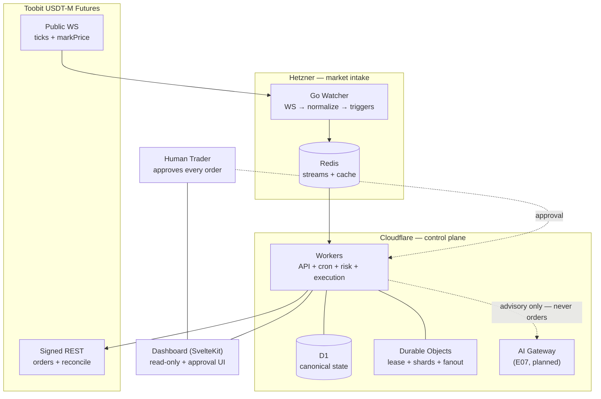

# AI Trading Agent — Toobit USDT-M Futures (paper-only until gate)

Independent repo. Human approval required before every new order. No live trading, no withdrawals.

- Docs: `docs/` (start: `docs/00-project-charter.md`, `docs/13-development-guide.md`)
- Backlog: `docs/tasks/BACKLOG.json` + `ROADMAP.md`
- Layout: `go-watcher/` (Go WS + watcher) · `workers/` (control plane) · `dashboard/` (SvelteKit — decided Q-01) · `migrations/` (D1, forward-only) · `schemas/` (event/API JSON-schema)

## Architecture at a glance



Solid = live market path; dashed = human/AI inputs (advisory — never a direct
order path). Execution plane is Cloudflare-only: signed submit + reconcile live
in Workers, canonical state in D1, and the Go Watcher never submits orders
(D-08). Paper-only until the signed gate. Details: `docs/02` (architecture) ·
`docs/03` (components) · `docs/14` (decisions) · `docs/07` (threat model).

## Quickstart (paper mode forced)
```bash
make check   # lint + JSON validate + secret scan
make dev     # local paper-mode stack (no live keys)
```

Safety: never commit secrets. `LIVE_TRADING_ENABLED` does not exist in MVP. See `docs/08-trading-risk-and-execution-safety.md`.
