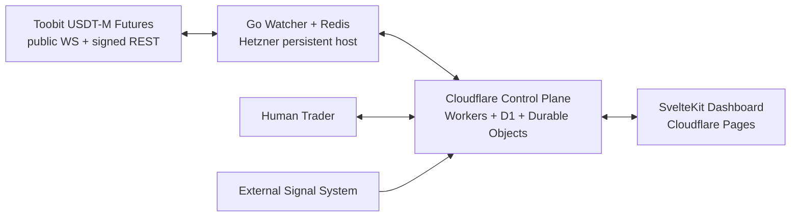
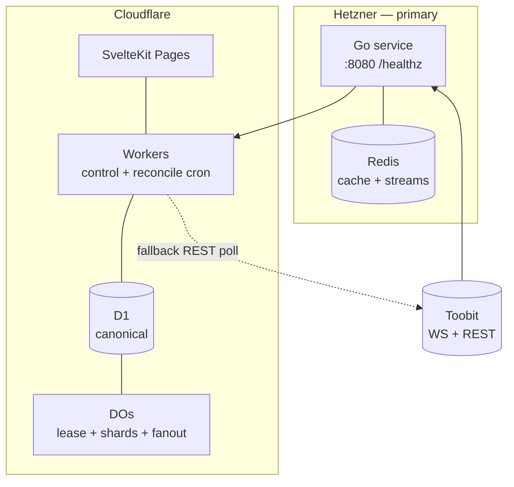

# 02 — System Architecture (context → containers → runtime → failures)

**Status:** APPROVED baseline | Diagrams: Mermaid, labelled. Conventions: `evt_<ulid>`, `intent_<ulid>`.

## 2.1 System context (C4 L1)

Primary flow (solid): Toobit WS → Go normalize → Redis Streams → Workers consumer → D1 (outbox) → analysis → approval → risk → submit → reconcile. Fallback flow (dashed in §2.5): Workers → D1 Watches → rate-limited REST poll.

## 2.2 Containers (C4 L2) — responsibilities & hard boundaries
| Container | Owns | Must NOT | Recovery |
|---|---|---|---|
| Go Watcher (Hetzner) | Outbound WS, normalize `{symbol,px,ts,src}`, in-memory last-px, trigger eval, heartbeat 5s, exp-backoff reconnect 1s→60s+jitter, stale detector, Fiber/plain HTTP `/healthz /readyz /watches/cache` (ops only) | Hold canonical business state, write D1 directly | Reload ACTIVE Watches from `GET /api/watches/active-snapshot` |
| Redis | `px:{sym}` hashes (TTL 30s), `watch:active:{id}`, Streams `events:*` (MAXLEN ~100k, 24h), consumer group `cg-workers` with acks | Durable record | RDB+AOF; Streams replay from last ack |
| Workers | Control API (§10), lifecycle, signal/analysis orchestration, approval, deterministic risk, execution+reconcile, recovery cron, dashboard BFF | Store ticks, hold WS | Stateless; state in D1 |
| D1 | Canonical: watches, transitions, signals, events, runs, approvals, intents, orders, positions, outbox, health, recovery log, strategy versions (§04) | Tick prices | Point-in-time restore; forward-only migrations |
| Durable Objects | `ExecutionAuthority` lease `{holder,epoch,expires}`; `WatchCoordinator-{shard}` fallback eval; `DashboardFanout` live push | Persistent WS, tick store | Lease state + shard cursors persisted |
| Dashboard (SvelteKit) | 11 views + LIVE/STALE/CACHED/UNAVAILABLE badges, degraded banner, audit timelines | Submit orders directly (always via Workers) | Static Pages; works bannered when backend degraded |

## 2.3 Trust boundaries (T1..T5)
- T1 Internet→Go: public market data only, no secrets, egress-allowlisted WS host.
- T2 Go↔Redis: private VPC, no public bind, AUTH + TLS where available.
- T3 Cloudflare internals: Workers→D1/DO via bindings (no public tokens).
- T4 Human→Workers: OIDC/JWT + RBAC (trader/operator/admin), approval requires step-up confirm.
- T5 Workers→Toobit REST: HMAC trade-only keys (no withdrawals), IP allowlist, per-key rate budget, signed `recvWindow=5000`.

## 2.4 Happy-path data flow (numbered)
1. Tick → Go normalize → `HSET px:{sym}` (TTL 30s) + evaluate the ACTIVE set
   (`triggerloop`): last-px map, `trigger.Eval`/`Invalidated`, `confirm_ticks`.
2. Trigger match → the loop POSTs the edge to the Worker
   (`POST /api/watches:trigger`, `x-agent-token`), carrying the tick price, the
   previous price, the per-watch seq and the version it evaluated. (The Redis
   `events:watch` emit stays available for the stream path; the D1 transaction
   lives in the Worker because the Go plane must never write D1 — E03-T01.)
3. Worker → D1 batch: `watch_transitions` (ACTIVE→TRIGGERED/INVALIDATED) +
   `events` (`watch.triggered_v1`, dedupe_key `type:watch_id:seq`) + `outbox`;
   a replay or a stale version is a no-op with an explicit reason.
4. Analysis run row (live WASM engine) → the watch moves TRIGGERED→ANALYZED →
   approval request → human decision → single-use token.
5. Risk gates (code) → intent row (`client_order_id=intent_id`) → signed submit → reconcile-to-terminal → position snapshot.

## 2.5 Deployment diagram (primary solid, fallback dashed)

## 2.6 Failure boundaries & consistency limits
- **D1 unavailable:** fail closed for orders; serve last-known reads bannered CACHED/STALE; queue mutations via outbox retry; pause reconcile submits, keep polling read-only.
- **DO partitioning:** one global `ExecutionAuthority` (single lease, 30s TTL, 10s renew, monotonic `epoch` fencing) + N `WatchCoordinator-{shard}` by `hash(symbol) % N` + `DashboardFanout`. A single global coordinator would bottleneck — sharding is mandatory.
- **Unhealthy definition (all recorded):** 3 missed Go heartbeats (15s) OR Redis stream lag >30s OR price staleness > per-symbol threshold. Workers cron (10s) evaluates and writes `health_snapshots` + `recovery_log`.
- **Trigger during failover:** refresh symbol via REST first; if refresh fails or is stale → record `HELD_UNCERTAIN`, notify, no order (SAFE-001).
- **Ack lost after submit:** mark `SUBMIT_UNKNOWN`, reconcile by `client_order_id` with backoff; never Blind-resubmit; alert if unresolved >5min.
- **Reconciliation scope:** all intents in `SUBMITTED | SUBMIT_UNKNOWN | ACKED | PARTIAL` must be reconciled with Toobit on every recovery.
- **Go+Redis restart:** must reload ACTIVE Watches from D1 snapshot; Redis loss alone is not business loss.
- **Dashboard ≠ execution:** separate badges; dashboard may be green while execution is halted (kill switch) and vice versa.
- **REST adequacy:** NOT assumed. Required math in ADR-004: `poll_interval ≥ symbols × reqs_per_symbol / rate_limit × 2`. Until proven, claim only "best-effort degraded quotes".

## 2.7 Interface to other docs
Components §03 · Data §04 · Events/FSM §05 · Failover §06 · Security §07 · Risk §08 · APIs §10.
