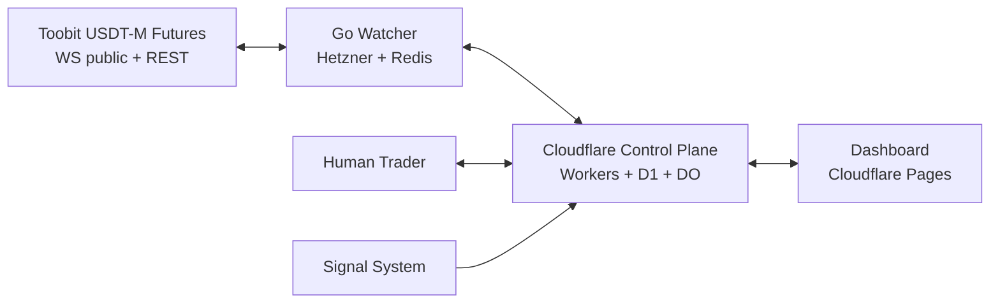
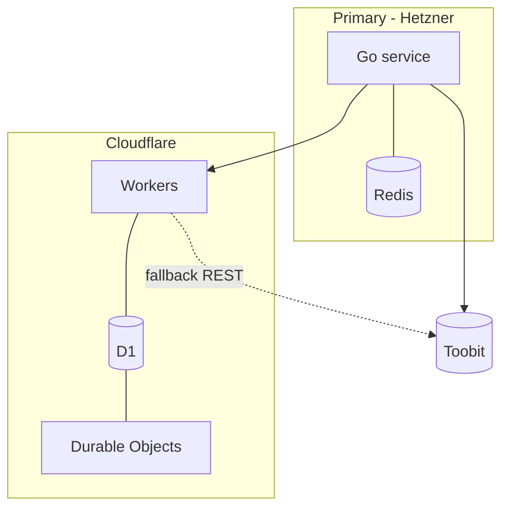

# 02 — System Architecture

## 2.1 Context (C4 L1)

Primary path: Toobit WS → Go → Redis Streams → Workers → D1. Fallback: Workers → D1 Watches → REST poll.

## 2.2 Containers (C4 L2) & responsibilities
| Container | Owns | Must NOT |
|---|---|---|
| Go Watcher | WS conn, normalize, in-memory last price, trigger eval, heartbeat, outbox→Redis | Sole-holder of business state |
| Redis | last-price cache, Watch cache, Streams buffer, consumer acks | Durable record (recoverable from D1) |
| Workers | Control API, lifecycle, orchestration, risk, approval, recovery, dashboard API | Tick storage, unlimited WS |
| D1 | Canonical Watches, signals, runs, approvals, intents, orders, positions, audit | Tick prices |
| Durable Objects | leases, failover state, live fan-out, fallback coordination | Persistent WS |

## 2.3 Trust boundaries
T1 Internet→Go WS (public data only). T2 Go→Redis (VPC/private). T3 Workers→D1/DO (Cloudflare). T4 Human→Workers (auth). T5 Workers→Toobit REST (signed, IP-allowlisted, no-withdraw keys).

## 2.4 Data flow (happy path)
1. Go normalizes tick → Redis `px:{sym}` + Stream `events:market`. 2. Watch trigger → Stream `events:watch` (stable ID `evt_<ulid>`). 3. Worker consumes, writes D1 `events`+`watch_transitions` (outbox). 4. Analysis run → approval request → risk check → intent → submit → reconcile.

## 2.5 Deployment diagram

Fallback path dashed; bannered degraded in dashboard.

## 2.6 Failure boundaries & D1 limits
- D1 unavailable → fail-closed for orders; serve cached reads bannered stale; queue writes via outbox retry, never invent state.
- DO partitioning: one `ExecutionAuthority` DO (single lease) + sharded `WatchCoordinator-{N}` + `DashboardFanout`. Single global DO would bottleneck; partition by symbol-hash.
- Unhealthy definition: missed 3 heartbeats (15s) OR Redis stream lag >30s OR price staleness > threshold. Lease expiry 30s, fencing token (monotonic `epoch`) required for execution authority.
- Trigger during failover: refresh via REST first; if uncertain → hold + record `HELD_UNCERTAIN`, no order.
- Unknown submit outcome: mark `SUBMIT_UNKNOWN`, poll reconcile with same `clientOrderId`, never resubmit blindly.
- Dashboard availability ≠ execution availability (separate badges).
- REST adequacy: NOT assumed; requires math (symbols × interval vs limits) in ADR-004.

## 2.7 Key sequences — see 05-events-and-state-machines.md for full diagrams.
