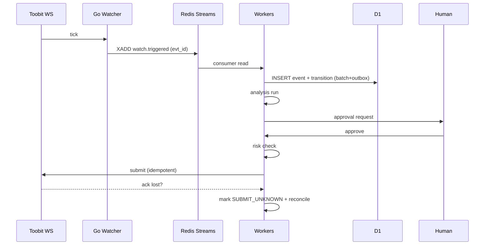

# 05 — Events & State Machines

## Event envelope
`{id: evt_<ulid>, type, v:1, entity_id, ts, actor, dedupe_key, payload}`. Dedupe on `(type,dedupe_key)` UNIQUE. Ordering: per-entity causal via `entity_id+seq`; global order not guaranteed. Retries: exp-backoff 1s→5min, DLQ after 10.

## Watch FSM
`DRAFT→ACTIVE→TRIGGERED→ANALYZED→APPROVED→ORDERED→CLOSED | EXPIRED | INVALIDATED`. Guards: only ACTIVE fires; TRIGGERED requires fresh price; APPROVED requires valid single-use approval.

## Order FSM
`INTENT→RISK_PASSED/RISK_REJECTED→SUBMITTED→SUBMIT_UNKNOWN→ACKED→PARTIAL→FILLED | REJECTED | CANCELLED | EXPIRED`. `SUBMIT_UNKNOWN` → reconcile-only, same clientOrderId.

## Position lifecycle
Derived from reconciled fills only; never from intent.

## Transactional outbox
Write business row + outbox row in one D1 batch; relay publishes to Streams/webhook; mark done on ack.

## Sequences

