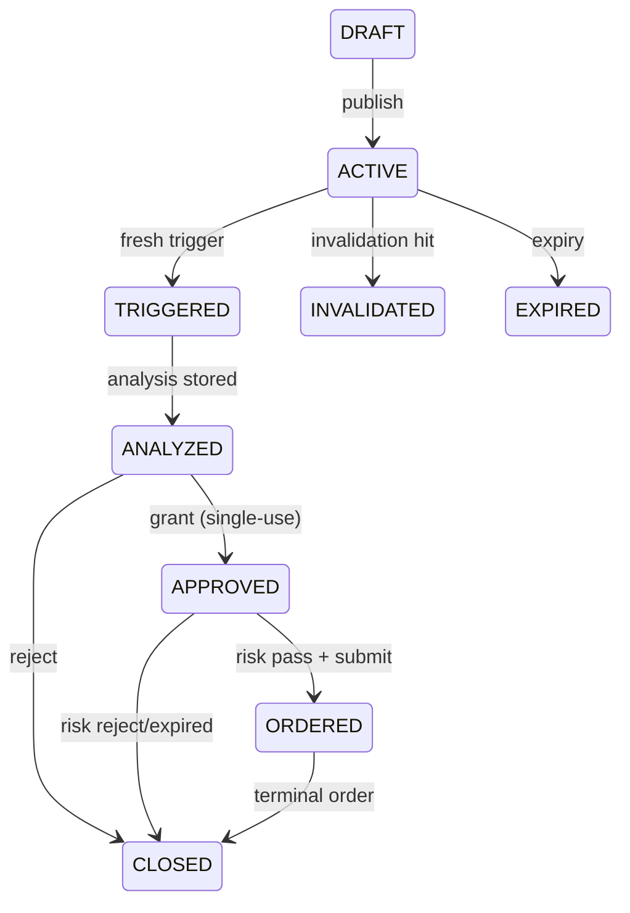
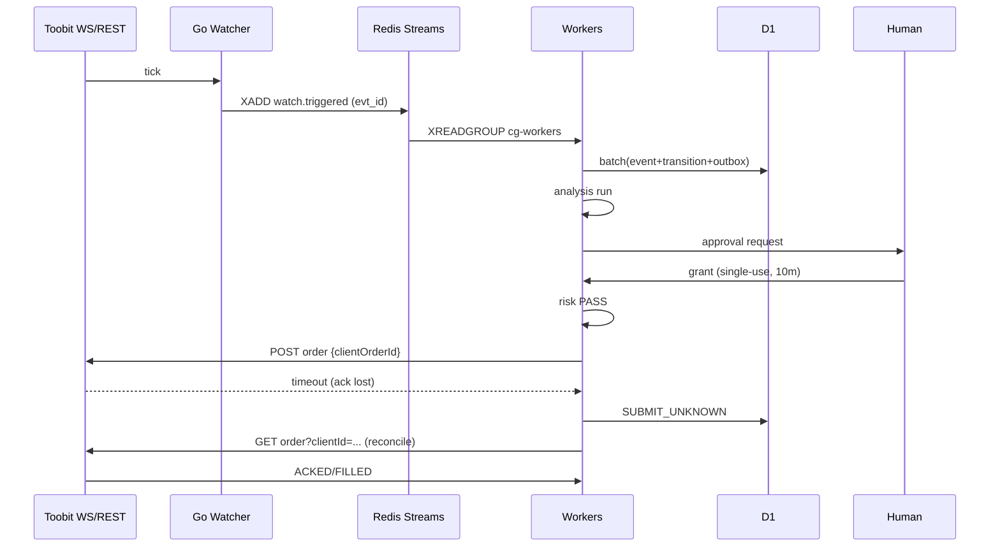

# 05 — Events & State Machines (envelopes · FSMs · outbox · sequences)

## 5.1 Event envelope (v1, JSON-schema in `schemas/event-envelope.schema.json`)
`{id: evt_<ulid>, type, v:1, entity_id, seq, ts, actor, dedupe_key, payload}`. `dedupe_key = type:entity_id:seq` UNIQUE in D1. Ordering: causal per `entity_id` via `seq`; no global ordering claim. Delivery: at-least-once; consumers dedupe. Retries exp-backoff 1s→5min, DLQ after 10 attempts with alert.

## 5.2 Canonical event types
`watch.created|triggered|held_stale|held_uncertain|invalidated|expired|closed` · `signal.ingested` · `analysis.completed` · `approval.requested|granted|rejected|expired|consumed` · `risk.passed|rejected` · `order.intent|submitted|ack_lost|acked|partial|filled|rejected|cancelled|expired` · `position.snapshot` · `health.degraded|recovered` · `lease.acquired|fenced|released` · `kill.engaged|released`.

## 5.3 Watch FSM

Guards: only ACTIVE evaluates; TRIGGERED needs fresh px; APPROVED needs unused+unexpired approval; every edge writes `watch_transitions` + event.

## 5.4 Order FSM
```mermaid
stateDiagram-v2
  INTENT --> RISK_PASSED
  INTENT --> RISK_REJECTED
  RISK_PASSED --> SUBMITTED
  SUBMITTED --> SUBMIT_UNKNOWN: ack lost/timeout
  SUBMITTED --> ACKED
  SUBMIT_UNKNOWN --> ACKED: reconcile found
  SUBMIT_UNKNOWN --> REJECTED: reconcile absent
  ACKED --> PARTIAL --> FILLED
  ACKED --> FILLED
  state ACKED etc --> REJECTED
  state ACKED etc --> CANCELLED
  state ACKED etc --> EXPIRED
```
Rules: `SUBMIT_UNKNOWN` = reconcile-only with same `client_order_id`; never blind-resubmit; alert >5min unresolved.

## 5.5 Transactional outbox
D1 batch: business row + `outbox` row atomically → relay (Workers) publishes to Streams/fanout → `done=1` on ack, else `next_retry` backoff. Consumers idempotent on `dedupe_key`.

## 5.6 Key sequences

Recovery variant: on boot, Workers sweep non-terminal intents → reconcile each by `client_order_id` before accepting new submits.
