# 19 — Bot Runs: Single-Strategy & Multi-Strategy Execution Pattern

**Status:** APPROVED 2026-10-20 | **Scope:** execution pattern only (no new service, no live flag) | **Mode:** paper-only until gate.

This doc answers: how does a trading robot "start" from one or many strategies and reach a trade, and which pattern this repo follows. Canonical mapping between the industry pattern (Freqtrade / Hummingbot / NautilusTrader / OS Engine) and this stack (Go watcher + Workers + D1 + human approval).

Related: docs 02 (architecture) · 03 (components) · 05 (FSM) · 08 (risk, normative) · 10 (APIs) · 17 (WASM runtime) · ADR-006/007/011.

## 19.1 The industry pattern (verified research)

All surveyed open-source robots share a 5-layer architecture:

```
Layer 1 Data Ingestion:   exchange WS/REST -> raw ticks/candles
Layer 2 Data Processing:  normalize + indicators (SMA, EMA, RSI, ATR)
Layer 3 Strategy:         entry/exit logic -> signal (advisory)
Layer 4 Execution & Risk: sizing, leverage, stops, risk gates -> order
Layer 5 Communication:    Telegram / dashboard / API / metrics
```

Reference loop — Freqtrade `freqtrade trade` (dry-run or live):

1. `bot_start()` runs once.
2. Loop every `process_throttle_secs`: fetch open trades, compute pairlist, download OHLCV once per candle, `bot_loop_start()`, per pair `populate_indicators()` -> `populate_entry_trend()` -> `populate_exit_trend()`, update open orders, check exits (stoploss, ROI, `custom_exit()`), check `max_open_trades` slots, then `leverage()` + `custom_stake_amount()` + `confirm_trade_entry()` -> submit.
3. Repeat until stopped.

Single-strategy = this loop with ONE strategy class. Multi-strategy = N strategies in parallel + one Aggregator / Portfolio Manager:

- Vote / weight: majority weighted by confidence wins.
- Veto: one ERROR / CHOP regime vetoes the whole signal.
- Priority: trend outranks range (pinned).
- Portfolio cap: even with 3x LONG, max_open_trades / exposure cap blocks the 2nd order.

## 19.2 Where this repo implements each layer

| Standard layer | This repo | Source of truth |
|---|---|---|
| Ingestion | Go watcher: Toobit WS/REST -> `normalize.Tick{symbol,px,ts,src}` | `go-watcher/tickfeed/`, `normalize/`, `conn/` |
| Processing | `FetchKlines` Toobit -> OKX -> Binance + ATR zones | `go-watcher/strategies/klines.go`, `aggregate.go` |
| Strategy | WASM sandbox (`wazero`, `wasip1`), immutable versions | `go-watcher/strategies/runner.go`, `registry.go`, `contract.go` |
| Signal bus | `POST /analyze` -> `verdicts[] + aggregate` (advisory) | `go-watcher/strategies/handler.go`, `analyze.go` |
| Trigger | snapshot(10s) -> `triggerloop.Set` -> tick -> Fire -> `POST /api/watches:trigger` | `go-watcher/triggerloop_endpoint.go` |
| Risk | 9 deterministic gates, fixed order, first-failure-wins | `workers/src/risk.mjs`, docs/08 §8.2 |
| Execution | Workers only: kill -> lease -> risk -> consume approval -> intent -> submit | `workers/src/execution.mjs` (D-08) |
| Approval | human single-use expiring token, every order | `workers/src/approvals.mjs`, docs/08 §8.3 |
| State | D1 canonical; Redis mirror; WASM bytes on disk | docs 04, docs 17 §17.3 |


## 19.3 The `BotRun` model (this repo's `freqtrade trade`)

A run is one advisory evaluation of 1..8 pinned strategies over 1..4 timeframes for one symbol. It IS `AnalyzeRequest` (`go-watcher/strategies/analyze.go`):

```json
{
  "symbol": "BTCUSDT",
  "direction": "LONG",
  "timeframes": ["5m", "15m", "1h"],
  "strategies": [
    {"id": "sma-cross", "version": "0.2.0", "config": {"min_confidence": 0.6}}
  ],
  "position": {"entry": "67000", "size": "0.01", "leverage": 5}
}
```

Rules (enforced in `handler.go:ServeAnalyze`):

- `symbol` required; `direction` empty or `LONG|SHORT`.
- `timeframes` 1..4 from `5m|15m|1h|4h`, default `5m,15m,1h`; zones derive from `tfs[0]`.
- `strategies` 1..8, each `{id, version}`; empty/`latest` resolves newest.
- Unknown strategy -> per-verdict `ERROR{VALIDATION}`, never a throw.

Single-strategy run: one entry in `strategies` -> `aggregate` echoes that verdict. Use for validating one artifact (e.g. `sma-cross@0.1.0` on `BTCUSDT`). Multi-strategy run: N entries x M timeframes = N*M verdicts -> `aggregate` rolls them up. Sample catalog (`strategies/samples/registry.json`): `sma-cross@0.1.0`, `sma-cross@0.2.0`, `sma-x-live@0.1.0`, `sma-x-v2@0.1.0`.

Per `(strategy, tf)` execution (`handler.go:runTF`):

```
bars,src = FetchKlines(symbol, tf)          // first venue that answers
cfg       = mergeConfig(entry.Configuration, s.Config)
inv       = Invocation{contract_version:"1", strategy_id, strategy_version,
            invocation_id:"inv_<sanitized>_<tf>_<n>",
            market_snapshot:{symbol,px:last.Close,ts,src,candles},
            strategy_configuration:cfg, previous_state:{},
            execution_context:{asof_ts, deadline_ms:500, trace_id:analyze_id}}
res       = runner.Run(ctx, entry.WASM, inv) // always one Result, faults -> ERROR
verdicts.append({strategy_id,version,sha256,tf,invocation_id,input_hash,result,data_source})
```

WASM contract (ADR-007, `schemas/strategy-*.schema.json`): `stdin = Invocation JSON`, `stdout = Result JSON`, 500ms deadline + 250ms grace, 64KB caps. `status: SIGNAL|NO_SIGNAL|ERROR`, `decision:{bias:LONG|SHORT|FLAT, confidence:0..1}`, `signals:[{kind:WASM_PROPOSAL, symbol}]` only, `diagnostics:{reason, code}`. Invalid output => `ERROR`, no downstream effect.

## 19.4 Aggregation (conflict resolution, advisory only)

`aggregate.go:aggregate(vs, want)`:

```
longW  = Σ confidence where bias=LONG  (ERROR excluded)
shortW = Σ confidence where bias=SHORT (ERROR excluded)
denom  = N - Errors
longW > shortW > 0  => {bias:LONG,  confidence:round2(longW/denom)}
shortW > longW > 0  => {bias:SHORT, confidence:round2(shortW/denom)}
else                => {bias:FLAT,  confidence:0}
```

Semantics (docs/17 §17.6): `aggregate.confidence` is a **vote share**, not a probability — per-verdict confidence is author-declared (sample SMAs return constants 0.62 LONG / 0.58 SHORT). Read raw weights in `aggregate.explanation` (`longW=1.24 shortW=0.58 flat=0`) and per-verdict `data_source` before trusting a number. A zone's provider is not necessarily the trading venue: klines fall through Toobit -> OKX -> Binance (verified `CELRUSDT -> -100010` on Toobit is analyzed on fallback).

The aggregate never approves, never submits (E08-T02). It feeds zones + watch creation, which still need human approval per order (SAFE-002).

## 19.5 Full lifecycle: start -> trade (paper-only)

```mermaid
flowchart LR
  S[SELECT Registry.Active only] --> A[ANALYZE POST /analyze]
  A --> Z[ZONES ATR trigger/inval]
  Z --> W[STALK POST /api/watches]
  W --> T[ARM triggerloop 10s]
  T --> F[FIRE POST watches:trigger]
  F --> G[SIGNAL WASM_PROPOSAL]
  G --> H[HUMAN APPROVAL single-use]
  H --> R[RISK 8 gates]
  R --> X[EXECUTE submit+reconcile]
  X --> P[POSITION from fills]
```



1. **SELECT:** new work pins only `Registry.Active()` (ADR-011). `retired` stays executable for in-flight refs but is not selectable.
2. **ANALYZE:** `POST /analyze` returns `{id, verdicts[], aggregate, suggest_zones}`.
3. **STALK:** `suggest_zones` (trigger `+-0.25xATR`, inval `+-1.0xATR`) one-clicks into `POST /api/watches` (DRAFT->ACTIVE same batch, docs/05 §5.3).
4. **ARM:** trigger loop reloads ACTIVE set every 10s; feed `rest` (ADR-004) or `ws`.
5. **FIRE:** edge POSTs `{watch_id,kind,px,prev_px,seq,watch_version}`; Worker owns the D1 tx (transition + event + outbox). Replay/stale => 200 no-op.
6. **SIGNAL:** `WASM_PROPOSAL -> POST /api/signals:ingest` (`signals.mjs` validators).
7. **APPROVAL:** human grants single-use token (TTL from `strategy_configs`, default 10m).
8. **RISK:** `risk.mjs:validate()` — R-KILL -> R-APPROVAL -> R-SYM -> R-LEV -> R-NOT -> R-EXP -> R-SLOT -> R-STALE -> R-DUP, first failure wins, unknown fails closed.
9. **EXECUTE:** `execution.mjs:submitIntent()` — kill -> lease fence -> risk -> consume approval -> insert intent (`client_order_id=intent_id` UNIQUE) -> signed submit -> persist. Timeout => `SUBMIT_UNKNOWN`, reconcile by client id only.
10. **POSITION:** `positionStatements()` from fills only (FR-010), exact decimal.

## 19.6 Authoring a new strategy (checklist)

1. Copy `go-watcher/strategies/template/` to a standalone dir (own `go.mod`, stdlib-only, never import the watcher or wazero).
2. Implement stdin->stdout contract v1 (golden req/resp in `schemas/fixtures/`).
3. Build: `make strategy-build SRC=path/to/strategy ID=<id> VERSION=<x.y.z>` (`GOOS=wasip1 GOARCH=wasm`).
4. Register row in `registry.json` (`id,version,file,configuration`) + `node scripts/validate-strategy-contract.mjs` (in `make check`).
5. Single-strategy dry run: `go run ./cmd/analyze-live -symbol BTCUSDT -strategies <id>@<ver>` must reproduce `POST /analyze`.
6. Multi-strategy run: add to `strategies[]` (max 8), read `aggregate.explanation` + `data_source` per verdict.
7. Lifecycle: `draft -> validating -> validated -> active -> disabled|failed`, `+retired` (no delete; new behaviour = NEW version; rollback = re-activate prior). D1 owns registry; Redis `strat:active:{id}`, `strat:lease:{inv}` (24h NX), `strat:state:{id}` (7d).
8. Never add secrets, net/fs, or order submission to the guest — isolation MVP: only `clock_nanos`, 500ms deadline.

## 19.7 Known gaps (multi-strategy hardening, proposed)

1. ~~**No portfolio slot cap** (`max_open_trades` equivalent)~~ — **CLOSED (E09-T01c)**: `R-SLOT` caps concurrent `ACTIVE` watches (global + per symbol) from the `v2-paper` config; docs/08 §8.6.
2. **No regime veto:** strong `FLAT` / `REGIME=CHOP` / `errors>30%` should force `aggregate=FLAT + DEGRADED`.
3. **Empty `PreviousState`:** `runTF` sends `{}`; stateful strategies need `strat:state:{id}` loaded + `proposed_state` checkpointed (docs/17 §17.3).
4. **Weight calibration:** sample confidences are constants; treat aggregate as vote share until per-strategy calibration exists (never display as win probability).

## 19.8 How to verify

- `make check` (contract validator + backlog + migrations + secret scan + tests).
- `cd go-watcher && go test ./...` — runner, registry, aggregate, klines fallback.
- `go run ./cmd/analyze-live -symbol BTCUSDT -strategies sma-cross@0.1.0`
- `go run ./cmd/replay && go run ./cmd/flap && go run ./cmd/restart-drill`
- Paper cycle: `node scripts/paper-cycle.mjs` + drills in `docs/ops/paper/`.

