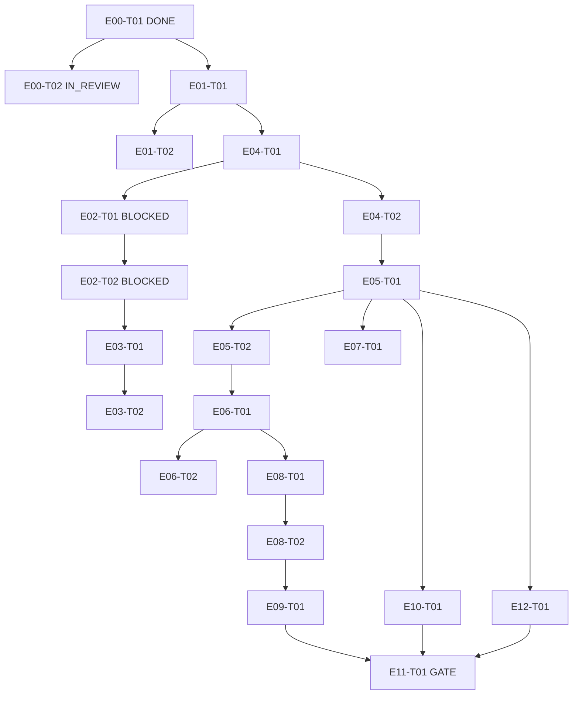

# Dependency Graph (task-level, acyclic — validated by `node scripts/validate-backlog.mjs`)

- P0 chain: E00→E01→E04→E06→E08→E09→E11. No cycles (validator asserts all deps resolve; wave order above is topological).
- External blocks: E02-T01/T02 on A-01/A-02 (Toobit docs). E10 unblocked (Q-01 SvelteKit decided 2026-10-10).
