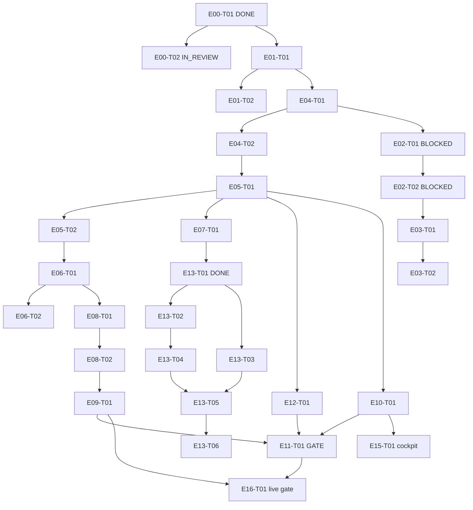

# Dependency Graph (task-level, acyclic — validated by `node scripts/validate-backlog.mjs`)

- P0 chain: E00→E01→E04→E06→E08→E09→E11. No cycles (validator asserts all deps resolve; wave order above is topological).
- External blocks: E02-T01/T02 on A-01/A-02 (Toobit docs). E10 unblocked (Q-01 SvelteKit decided 2026-10-10).
- E15 (cockpit, docs/20) hangs off E10 — UI only, off the trading critical path.
- E16 (live readiness, docs/21) hangs off E11 + E09 — it is a **gate**, and the edge
  into it means "the paper proof and the submit path both exist", not "live is on".
  `LIVE_TRADING_ENABLED` cannot ship before E16 completes (docs/13 §13.8).
